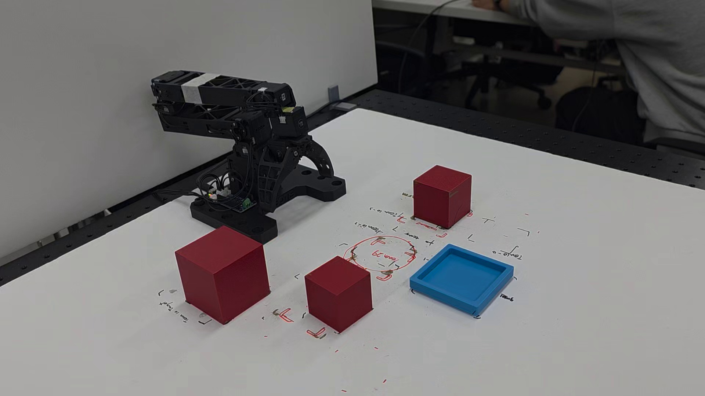
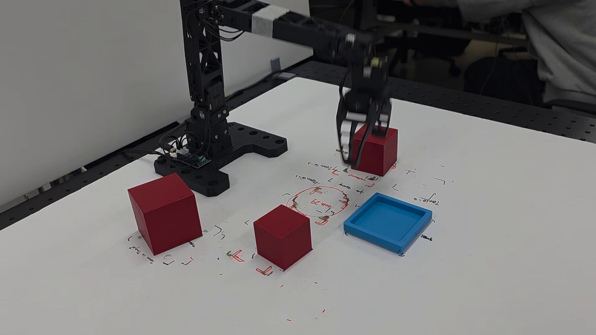
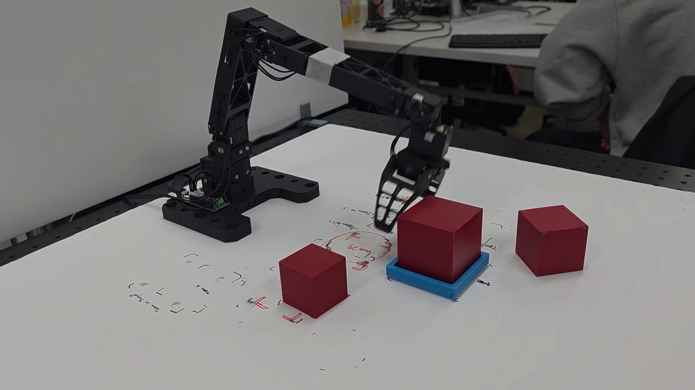
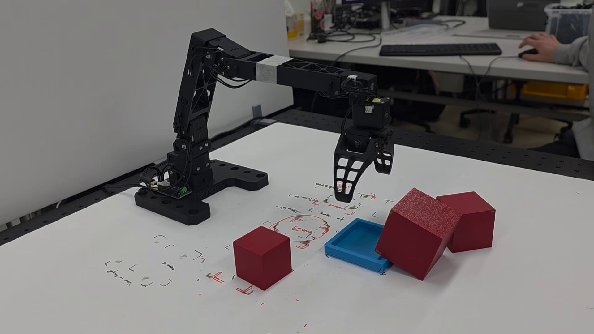

# OMX 로봇 팔 모방학습: ACT로 블록 쌓기

ROBOTIS OMX 리더-팔로워 로봇 팔로 사람의 시연을 녹화하고, Hugging Face LeRobot의 ACT 정책을 학습해 실제 로봇에서 블록 쌓기를 시도한 팀 프로젝트입니다. 실제 로봇에서 성공률은 0%였습니다. 이 결과를 설정 파일, 모델 파일, 데이터 메타데이터와 실행 영상으로 되짚어 실패 원인을 분석했습니다.

| 항목 | 내용 |
| --- | --- |
| 기간 | 2026.11.10 ~ 2026.11.23 (팀 6, 5명) |
| 작업 | 크기가 다른 빨간 블록 3개를 파란 트레이 위에 큰 것 → 중간 → 작은 것 순서로 쌓기 |
| 로봇 | ROBOTIS OMX (리더 OMX-L + 팔로워 OMX-F, 관절 5 + 그리퍼 1) |
| 모델 | ACT (Action Chunking with Transformers), LeRobot 0.2.0 |
| 데이터 | 에피소드 25개 저장, 학습에 23개 사용 (19,300프레임, 30 fps) |
| 결과 | 학습 loss 약 3.4 → 약 0.10으로 수렴, 실제 로봇 성공률 0% |
| 내 역할 | 보고서 5장 "실험 환경 및 학습 과정" 담당: 하드웨어·소프트웨어 환경 정리, 데이터셋 구성 분석, 모델 파일 분석, 학습 과정 기록 |

## 진행 과정

| 날짜 | 단계 | 내용 |
| --- | --- | --- |
| 11/10, 11/11 | 데이터 수집 | 리더 팔 텔레오퍼레이션으로 약 50회 시연, 그중 25개 에피소드 저장 |
| 11/16 | 학습 | RTX 3080 1장에서 약 42분, 29,000 step까지 진행 (25,000 step 체크포인트 사용) |
| 11/18 | 추론 실험 | 기본 조건 + 변형 3가지 모두 실패, 실행 영상 3개 분석 |
| 11/19 ~ 11/21 | 분석 | 설정 파일·모델 파일·메타데이터 대조, 실패 원인 정리 |
| 11/23 | 제출 | 8장 구성 보고서 PDF 제출 |

## 시스템 구성

```
[리더 OMX-L] --관절각 q--> [팔로워 OMX-F]   (q' = S·q + b, 100 Hz 위치 제어)
      |                         |
   action (6)          observation.state (6)      [camera1: C922, 640×480]
      \_________________________|__________________________/
                                v
                  LeRobot 데이터셋 (30 fps, 프레임 단위 저장)
                                v
                       ACT 학습 (RTX 3080)
                                v
           추론: camera1 영상 + 관절 상태 → 100 step 행동 묶음
```

- 미들웨어: ROS 2 Jazzy + ros2_control (Docker 컨테이너)
- 녹화·추론 도구: ROBOTIS physical_ai_tools 웹 화면
- 카메라: 작업대 정면 1대, 깊이 카메라·손목 카메라 없음

자세한 내용: [docs/01_실험환경_및_학습.md](docs/01_실험환경_및_학습.md)

## 결과

| 조건 | 확인하려 한 것 | 결과 |
| --- | --- | --- |
| 기본: 수집 때와 같은 위치에 블록 3개 | 작업을 처음부터 끝까지 수행하는가 | 실패 |
| 변형 ①: 그리퍼에 블록을 손으로 넣어 줌 | 잡기를 건너뛰면 옮기기·놓기는 하는가 | 실패 |
| 변형 ②: 큰 블록을 미리 트레이에 옮겨 둠 | 두 번째 블록부터 이어서 하는가 | 실패 |
| 변형 ③: 블록 2개를 미리 쌓아 둠 | 마지막 블록만 쌓는가 | 실패 |

공통 패턴: 로봇은 블록과 트레이 쪽으로 대략적인 경로는 따라갑니다. 하지만 블록 위에서 정밀하게 잡거나 놓지 못하고, 블록을 밀거나 쓰러뜨린 뒤 맴돌다 멈췄습니다.

| 기본 배치 시작 | 블록 접근 | 위 블록을 밀어냄 | 허공에서 멈춤 |
| --- | --- | --- | --- |
|  |  |  |  |

자세한 내용: [docs/02_결과_및_분석.md](docs/02_결과_및_분석.md)

## 실패 원인 분석 요약

1. **데이터가 적고 단조로움:** 학습 에피소드 23개는 ACT 논문의 태스크당 약 50개의 절반 이하입니다. 23개 모두 같은 시작 배치와 같은 순서로 진행돼서, 모델이 장면을 보고 다음 단계를 판단하기보다 초기 자세에서 시작하는 궤적을 통째로 외운 것으로 보입니다. 변형 ②·③에서 로봇이 남은 블록이 아니라 이미 놓인 블록 쪽으로 간 것이 그 근거입니다.
2. **긴 action chunk와 중간 보정 부재:** chunk_size와 n_action_steps가 모두 100이고 temporal ensembling이 꺼져 있었습니다. 모델은 약 3.3초에 한 번만 새 관측을 보므로, 블록이 밀려도 다음 예측까지 그대로 진행합니다.
3. **관측의 한계:** 정면 카메라 1대만으로는 블록 위에 블록을 올릴 때 필요한 높이·앞뒤 간격을 구분하기 어렵습니다.
4. **시연 품질:** 리더-팔로워가 단방향이라 힘 피드백이 없고, 두 팔의 링크 길이가 달라(335 mm vs 400 mm) 팔로워를 눈으로 보며 조작해야 했습니다. 둘째 날은 조작에 익숙해져 시연 속도가 빨라졌습니다.
5. **데이터 검수 부재:** 11·18번 에피소드는 메타데이터상 901프레임이지만 실제 영상은 350·50프레임뿐이라 학습에서 제외됐습니다. 수집 당일에는 이를 알지 못했습니다.

## 직접 확인한 것

- **모델 파일 분석:** `model.safetensors`(206.7 MB)를 열어 전체 파라미터 51,668,656개를 셌습니다. 학습 때만 쓰는 CVAE 인코더를 빼면 추론에 쓰는 파라미터는 약 3,420만 개입니다.
- **정규화 통계 분석:** 모델에 저장된 평균값을 비교하니 관절 1~5는 상태와 행동의 차이가 0.024 이하였지만, 그리퍼만 상태 0.420, 행동 0.265로 크게 달랐습니다. 리더는 더 닫으라고 명령했지만 팔로워 그리퍼는 블록에 막혀 덜 닫힌 것입니다.
- **학습 설정 대조:** `train_config.json`의 에피소드 목록과 데이터셋 메타데이터를 대조해, 약 50회 시연 중 25개만 저장되고 23개만 학습에 쓰인 경위를 확인했습니다.
- **학습 로그 분석:** 30,000 step 설정이 29,000 step 직후 수동 종료돼, 5,000 step 간격 저장 때문에 25,000~29,000 step 학습이 모델에 반영되지 않았음을 확인했습니다.

## 다시 한다면

| 개선안 | 겨냥하는 문제 |
| --- | --- |
| temporal ensembling 켜기 또는 n_action_steps를 20~30으로 줄이기 | 중간 보정 부재. 재학습 없이 추론 설정만으로 확인 가능 |
| 녹화 직후 에피소드 수·영상 길이 검수 | 손상 데이터, 저장 누락 |
| 시연자 연습 후 일정한 속도로 50~100개 수집 | 데이터 양과 일관성 |
| 블록 배치를 다양하게 하거나 중간 단계에서 시작하는 시연 추가 | 장면에 따른 단계 판단 |
| 손목 카메라 추가, 영상 증강 켜기, 수집·추론을 같은 조명에서 | 관측 부족, 조명 변화 |
| 체크포인트 저장 간격을 1,000 step으로 줄이기 | 학습 중단 시 손실 |

## 배운 점

- 학습 loss가 낮다는 것과 실제 로봇에서 성공하는 것은 별개입니다. loss는 시연을 얼마나 잘 따라 하는지만 잽니다.
- 모방학습 정책의 수준은 시연의 양과 일관성을 넘지 못합니다. 모델보다 데이터 수집 절차와 검수가 먼저입니다.
- 실패한 실험도 설정 파일, 모델 가중치, 메타데이터, 영상을 대조하면 원인을 구체적으로 좁힐 수 있습니다.

## 폴더 구조

```
docs/          실험 환경·학습, 결과·분석 문서
00_작업기록/   날짜별 진행 기록
03_학습설정/   config.json, train_config.json
04_미디어/캡처/ 실험 셋업, 추론 장면, 흐름도
```

학습된 가중치 `model.safetensors`(206.7 MB)와 시연·추론 영상은 용량 때문에 저장소에 넣지 않았습니다.

## 참고문헌

1. T. Z. Zhao, V. Kumar, S. Levine, C. Finn. "Learning Fine-Grained Bimanual Manipulation with Low-Cost Hardware." RSS 2023. [arXiv:2304.13705](https://arxiv.org/abs/2304.13705)
2. M. Shukor et al. "SmolVLA: A Vision-Language-Action Model for Affordable and Efficient Robotics." 2025. [arXiv:2506.01844](https://arxiv.org/abs/2506.01844)
3. ROBOTIS. [OMX 공식 문서](https://docs.robotis.com/docs/systems/omx/introduction/)
4. ROBOTIS. [OMX LeRobot 모방학습 가이드](https://ai.robotis.com/omx/lerobot_imitation_learning_omx.html)
5. Hugging Face. [LeRobot](https://github.com/huggingface/lerobot)
