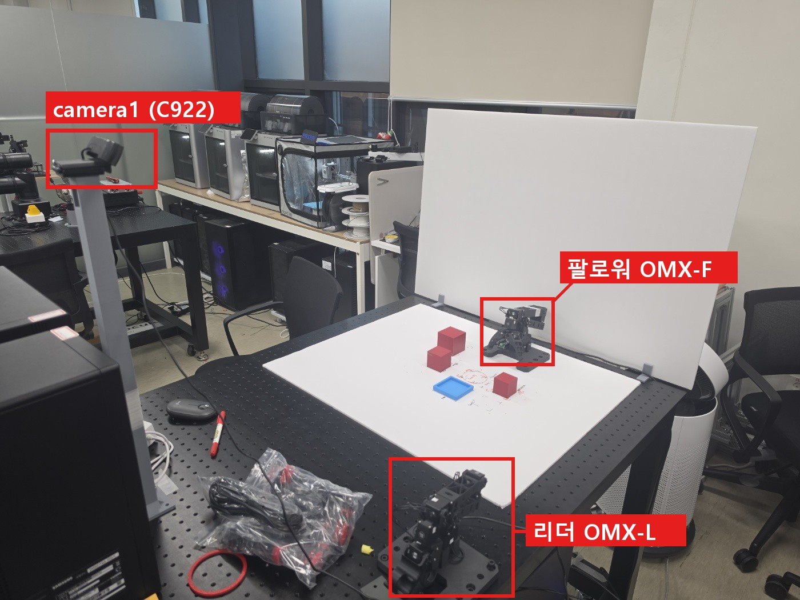
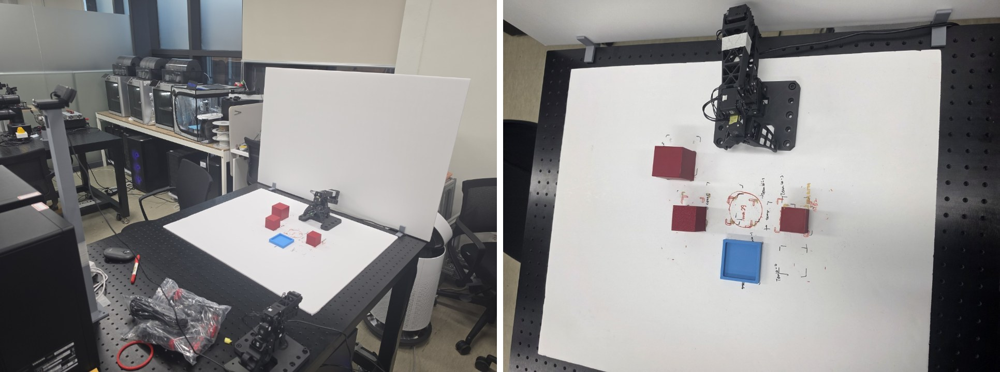
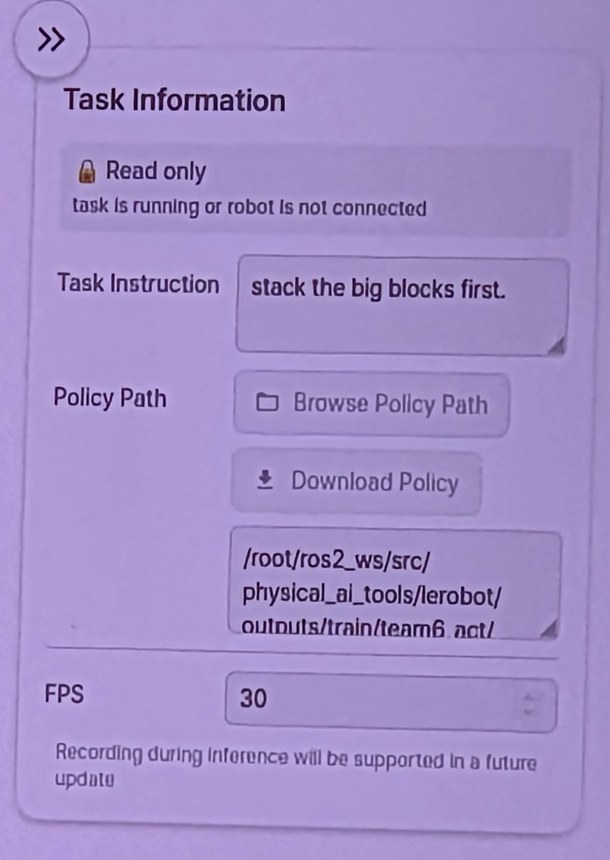
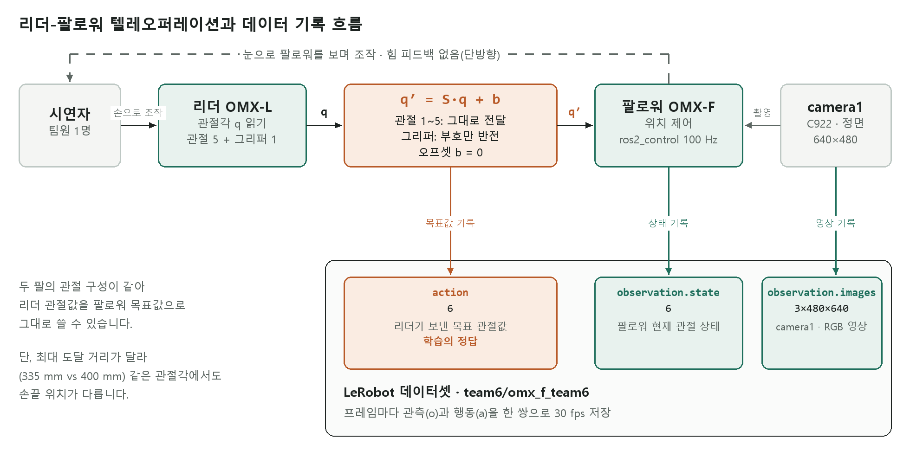
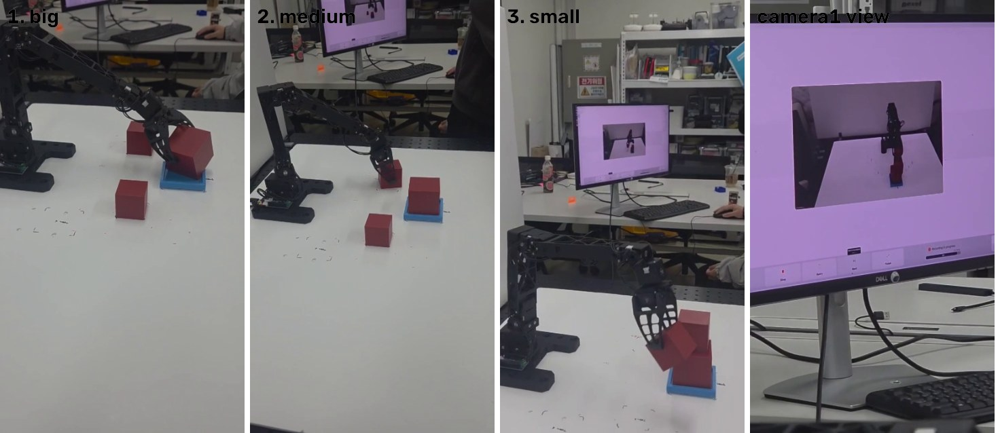
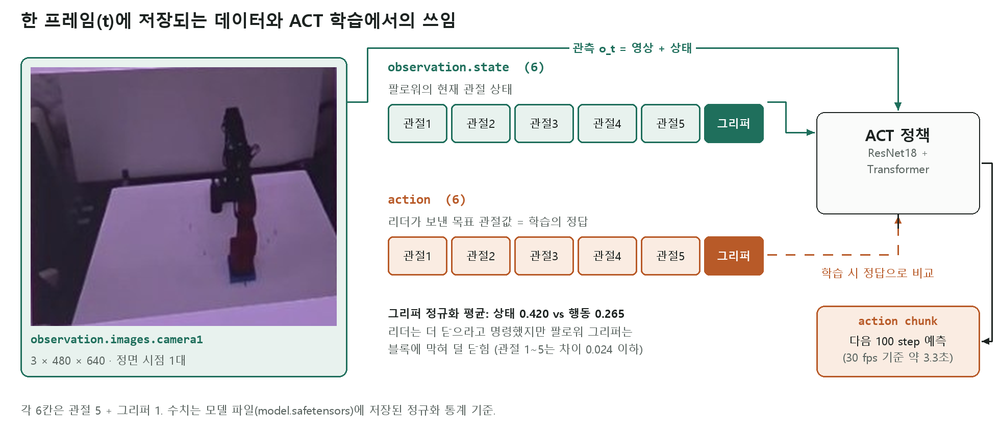

# 실험 환경 및 학습 과정

시연은 11/10과 11/11 두 차례 실습에서 녹화했고, 데이터셋에는 25개 에피소드(21,102프레임)가 저장됐습니다. 이 중 영상이 손상된 2개를 뺀 23개 에피소드(19,300프레임)로 학습했고, 11/18 추론에는 25,000 step 체크포인트를 썼습니다.

수치의 근거는 연구실 PC의 설정 파일([config.json](../03_학습설정/config.json), [train_config.json](../03_학습설정/train_config.json)), 모델 파일(model.safetensors), 실습 조교를 통해 확인한 데이터셋 메타데이터와 학습 로그, ROBOTIS 공식 문서, 현장 사진·영상입니다.

## 1. 하드웨어와 소프트웨어

### 1.1 로봇: ROBOTIS OMX

OMX는 사람이 직접 잡고 움직이는 리더 OMX-L과, 이를 따라 움직이며 실제 작업을 하는 팔로워 OMX-F로 이루어진 모방학습용 로봇 팔입니다. 두 팔은 관절 구성이 같아서 리더의 관절값을 팔로워의 목표값으로 그대로 쓸 수 있습니다. 관절 상태와 행동이 6차원인 것은 이 "관절 5개 + 그리퍼 1개" 구성 때문입니다.

| 항목 | 팔로워 OMX-F | 리더 OMX-L |
| --- | --- | --- |
| 역할 | 작업 수행, 학습된 정책이 제어 | 사람이 직접 움직여 시연 |
| 자유도 | 관절 5 + 그리퍼 1 | 관절 5 + 그리퍼 1 |
| 구동기 | XL430-W250-T × 3, XL330-M288-T × 3 | XL330-M288-T × 5, XL330-M077-T × 1 |
| 최대 도달 거리 | 400 mm | 335 mm |
| 가반 하중 | 일반 250 g (최대 도달 시 100 g) | 해당 없음 |
| 통신 | USB-C, TTL 1 Mbps | USB-C, TTL 1 Mbps |

출처: [ROBOTIS OMX 하드웨어 사양](https://docs.robotis.com/docs/systems/omx/specifications/hardware)

### 1.2 작업 환경과 카메라

실험은 지하 실습실의 같은 작업대에서 했습니다. 팀별 1시간 단위로 예약해 썼고, 데이터 수집은 11/10(화) 14~15시와 11/11(수) 12~13시, 추론은 11/18(수) 12~13시였습니다.

- **작업대:** 광학 브레드보드 테이블 위에 흰색 보드를 깔고, 로봇 뒤에 흰색 배경 패널을 세웠습니다. 블록과 트레이의 시작 위치를 보드에 펜으로 표시해 매 에피소드의 시작 조건을 통일했습니다.
- **작업 물체:** 크기가 다른 빨간 정육면체 블록 3개(대·중·소)와 파란 트레이 1개.
- **카메라:** Logitech C922 Pro Stream Webcam 1대(camera1). 640×480 RGB, 30 fps로 저장했습니다. 작업대 앞 기둥에 고정한 정면 시점이며, 팔로워에서 약 1 m, 작업대 면보다 약 40~50 cm 높은 위치입니다(사진으로 본 대략값). 깊이 카메라와 손목 카메라는 없습니다.

| 카메라 위치 | 블록 시작 위치 (탑뷰) |
| --- | --- |
|  |  |

### 1.3 소프트웨어와 컴퓨터

| 구분 | 내용 |
| --- | --- |
| 로봇 미들웨어 | ROS 2 (Jazzy) + ros2_control, 관절 제어 100 Hz |
| 학습 프레임워크 | Hugging Face LeRobot 0.2.0, ACT 정책 |
| 실습 도구 | ROBOTIS physical_ai_tools (웹 화면에서 녹화·추론) |
| 실행 환경 | Docker 컨테이너 안의 ROS 2 워크스페이스, Ubuntu |
| 연산 장치 | NVIDIA GeForce RTX 3080 10 GB, FP32 (혼합 정밀도 사용 안 함) |
| 메모리 | RAM 32 GB |

추론 때는 physical_ai_tools 화면에 작업 지시문 "stack the big blocks first.", 정책 경로 `outputs/train/team6_act`, 30 FPS를 입력해 실행했습니다.

### 1.4 텔레오퍼레이션 방식

리더에서 읽은 관절각 q가 팔로워의 목표 관절각 q′가 됩니다(q′ = S·q + b). OMX 기본 설정에서는 팔 관절 1~5를 그대로 전달하고, 그리퍼는 부호만 반전하며, 오프셋 b는 0입니다. 팔로워는 목표각과 실제 각도의 오차를 줄이는 위치 제어로 따라갑니다.

두 팔의 링크 길이가 달라서(최대 도달 거리 335 mm vs 400 mm) 같은 관절각에서도 손끝 위치가 다릅니다. 그래서 시연자는 리더가 아니라 팔로워를 보며 조작해야 합니다. 또 힘 피드백이 없는 단방향 방식이라, 팔로워가 블록에 닿는 느낌이 리더로 전달되지 않습니다.

## 2. 데이터 수집

### 2.1 작업

빨간 블록 3개를 파란 트레이 위에 큰 블록 → 중간 블록 → 작은 블록 순서로 쌓습니다. 수업에서 제시된 선택지(블록 쌓기, 물체 집어 넣기) 중 집기와 놓기가 세 번 이어지는 블록 쌓기를 골랐습니다. 작업 지시문은 입력했지만, ACT는 영상과 관절 상태만 입력으로 받기 때문에 지시문은 실제 동작 생성에 쓰이지 않습니다.

### 2.2 에피소드 녹화 절차

1. **연습과 동기화:** 리더를 작게 움직여 모든 관절과 그리퍼가 팔로워에 대응하는지 확인하고, 두 팔을 같은 초기 자세로 맞춘 뒤 동기화합니다. 자세가 다르면 동기화 순간 팔로워가 급하게 움직일 수 있습니다.
2. **물체 배치:** 블록 3개와 트레이를 표시한 위치에 놓습니다.
3. **녹화:** 시연자가 리더를 움직이면 팔로워가 100 Hz로 따라 움직이고, 카메라 영상·팔로워 관절 상태·리더 관절값이 30 fps로 함께 기록됩니다. 에피소드는 최대 30초이고, 작업을 마치면 완료 버튼으로 끝냅니다.
4. **리셋:** 블록을 표시 위치로 되돌리고 다음 에피소드를 녹화합니다.

11/10에는 목표 50회 중 약 30회, 11/11에는 나머지 약 20회를 녹화했습니다. 두 날 모두 같은 팀원 한 명이 리더를 조작했고, 나머지 팀원은 녹화 조작, 블록 리셋, 촬영, 자세·배치 점검을 나눠 맡았습니다.

### 2.3 데이터 구성

데이터셋 이름은 `team6/omx_f_team6`(LeRobot 형식)이고, 한 프레임마다 관측과 행동이 한 쌍으로 저장됩니다.

| 데이터 항목 | 형태 | 내용 |
| --- | --- | --- |
| observation.images.camera1 | 3 × 480 × 640 | 정면 카메라 RGB 영상 |
| observation.state | 6 | 팔로워의 현재 관절 상태 (관절 5 + 그리퍼 1) |
| action | 6 | 리더가 보낸 목표 관절값 (학습의 정답) |

학습에 쓴 23개 에피소드는 평균 약 839프레임, 30 fps 기준 약 28초입니다. 영상 속 한 번의 시연은 약 20초였으므로, 상당수 에피소드에는 작업을 끝낸 뒤 멈춰 있는 구간도 함께 녹화됐을 것으로 보입니다.

모델 파일에 저장된 정규화 통계를 보면, 관절 1~5는 상태와 행동의 평균 차이가 0.024 이하입니다. 반면 그리퍼만 상태 0.420, 행동 0.265로 크게 다릅니다. 리더는 더 닫으라고 명령했지만 팔로워 그리퍼는 블록에 막혀 덜 닫힌 것입니다. 모델은 블록을 잡는 구간에서 이 차이까지 학습해야 합니다.

### 2.4 에피소드 수

| 구분 | 에피소드 번호 | 개수 | 프레임 |
| --- | --- | --- | --- |
| 데이터셋 전체 | 0~24 | 25 | 21,102 |
| 학습에 사용 | 0~10, 12~17, 19~24 | 23 | 19,300 |
| 제외 (영상 손상) | 11, 18 | 2 | 메타데이터상 각 901 |

11번과 18번은 메타데이터에 901프레임으로 기록됐지만 실제 영상은 350프레임과 50프레임뿐이었습니다. 로봇 상태에 대응하는 영상 프레임을 불러올 수 없어 학습에서 제외됐습니다.

팀이 녹화한 횟수는 약 50회였지만 저장된 에피소드는 25개입니다. 블록을 놓치거나 탑이 무너진 시도는 reset 버튼으로 중단해 저장하지 않았으므로, 약 50회에는 저장되지 않은 실패 시도가 포함됐을 가능성이 큽니다. 시도별 기록이 남아 있지 않아 정확한 횟수는 확인할 수 없습니다.

학습에 쓴 23개는 ACT 논문의 태스크당 시연 수(약 50개)의 절반에 못 미치고, 수업에서 권장한 100회 이상과는 차이가 더 큽니다. 검증용 에피소드도 따로 나누지 않았습니다.

### 2.5 수집 과정에서 생긴 문제

- **시연 속도의 편차:** 같은 시연자라도 회차와 시간대에 따라 속도가 달랐습니다. 조작에 익숙해진 11/11에는 첫날보다 빨랐습니다. 속도가 다르면 같은 상황에서도 행동이 달라져 모델이 배울 기준이 흐려집니다.
- **리더 조작의 어려움:** 두 팔의 링크 길이가 달라 손의 위치와 팔로워 손끝 위치가 일치하지 않고, 힘 피드백이 없어 팔로워를 눈으로 보며 조작해야 했습니다.
- **그리퍼의 마찰력 부족:** 팔로워 그리퍼 표면의 마찰력이 작아, 블록을 옮기는 도중 미끄러지는 경우가 있었습니다.
- **마지막 단계 실패 시 전체 재녹화:** 앞의 두 블록을 잘 쌓아도 마지막 블록에서 탑이 무너지면 처음부터 다시 녹화해야 했습니다. 단계가 쌓일수록 허용 오차가 작아져 성공 에피소드 하나를 얻는 시간이 늘었습니다.
- **녹화 결과 확인 부족:** 녹화 직후 저장된 에피소드 수와 영상 길이를 확인하는 절차가 없어, 11·18번 영상 손상과 저장 개수 차이를 수집 당일에는 알아차리지 못했습니다.

## 3. 모델 학습

### 3.1 모델 선택

ACT(Action Chunking with Transformers)를 썼습니다. 팀이 특정 모델을 요청하지 않아 학습을 맡은 실습 조교가 기본 모델인 ACT로 학습했습니다. 돌아보면 ACT는 이 작업에 맞는 선택이었습니다.

- 언어로 작업을 구분할 필요가 없는 단일·고정 작업입니다.
- 수십 개 수준의 시연으로 처음부터 학습할 수 있습니다.
- GPU 1장에서 학습·추론이 가능한 크기입니다.
- ROBOTIS 공식 OMX 모방학습 가이드의 기본 예시 정책도 ACT입니다.

### 3.2 ACT 구조 (본 팀 설정 기준)

1. **영상 토큰화:** 640×480 영상이 ResNet18을 거쳐 20×15 특징 지도가 되고, 300개의 512차원 영상 토큰과 2D 위치 임베딩이 만들어집니다.
2. **상태와 잠재 변수:** 관절 상태 6개가 토큰 1개, CVAE 잠재 변수 z(32차원)가 토큰 1개가 됩니다.
3. **인코더:** 302개 토큰을 4층 Transformer 인코더가 함께 처리합니다.
4. **디코더:** 학습된 위치 쿼리 100개가 cross-attention으로 인코더 표현을 참조해, 100 step 뒤까지의 행동을 한 번에 만듭니다.
5. **실행:** 정규화된 출력을 실제 관절값으로 되돌려 팔로워에 보냅니다.

CVAE 인코더는 학습 때만 씁니다. 추론 때는 z = 0을 넣으므로, 같은 입력이면 항상 같은 행동이 나오는 결정론적 정책이 됩니다. 학습 손실은 행동 복원 오차(L1)와 KL 항(β = 10)의 합입니다.

### 3.3 학습 데이터셋 구성

23개 에피소드(19,300프레임)를 모두 학습에 썼고 검증용 분리는 하지 않았습니다. 영상·상태·행동은 모두 평균·표준편차로 정규화했고, 영상에는 ImageNet 표준값을 썼습니다. 설정 파일에 밝기·대비·채도 등 영상 증강이 준비돼 있었지만 꺼져 있었습니다(`image_transforms.enable: false`).

### 3.4 주요 하이퍼파라미터

| 항목 | 값 | 항목 | 값 |
| --- | --- | --- | --- |
| 영상 백본 | ResNet18 (ImageNet 사전학습) | 학습 step | 30,000 (설정값) |
| 모델 차원 / head | 512 / 8 | batch size | 8 |
| Transformer 인코더 / 디코더 | 4층 / 1층 | optimizer | AdamW (β 0.9, 0.999) |
| CVAE 잠재 변수 / KL weight | 32차원 / 10 | learning rate | 1e-5 (백본 동일, 고정) |
| chunk_size / n_action_steps | 100 / 100 | weight decay / grad clip | 1e-4 / 10 |
| temporal_ensemble_coeff | null (사용 안 함) | 체크포인트 저장 | 5,000 step마다 |
| dropout | 0.1 | seed | 1000 |

하이퍼파라미터는 따로 조정하지 않고 LeRobot ACT 기본값을 썼습니다. chunk_size 100, batch 8, 학습률 1e-5, KL weight 10, 잠재 변수 32차원은 ACT 논문의 기본값과 같고, 디코더만 논문의 7층이 아닌 1층입니다.

chunk_size와 n_action_steps가 모두 100이라, 모델은 한 번 예측한 100 step(약 3.3초)을 모두 실행한 뒤에야 새 관측으로 다시 예측합니다. Temporal Ensembling도 꺼져 있어 겹치는 예측을 평균하지 않습니다.

### 3.5 학습 과정과 모델 크기

- RTX 3080 1장에서 11/16 15시 25분경 시작해 16시 7분경 끝났습니다. 29,000 step까지 약 42분(초당 약 11.5 step)이 걸렸습니다.
- 체크포인트는 5,000 step마다 저장됐고, 추론에는 마지막 저장본인 25,000 step 모델을 썼습니다. loss는 1,000 step마다 기록됐습니다.
- 모델 파일(model.safetensors, 206.7 MB)의 전체 파라미터는 51,668,656개입니다. 학습 때만 쓰는 CVAE 인코더를 빼면 추론에 쓰는 파라미터는 약 3,420만 개입니다.

### 3.6 학습 중 생긴 문제

- **학습 조기 종료:** 30,000 step으로 설정했지만, 29,000 step의 loss가 기록되고 약 45초 뒤 수동 종료 신호(Ctrl+C)로 멈췄습니다. 중단 사유는 기록에 없습니다. 체크포인트가 5,000 step마다만 저장돼 25,000~29,000 step의 학습은 모델에 반영되지 않았습니다.
  - 대응: 마지막 체크포인트인 25,000 step 모델로 추론했습니다.
  - 다시 한다면: 저장 간격을 1,000 step 정도로 줄이고, 설정한 step까지 끝났는지 확인한 뒤 종료합니다.
- **추가 학습 불가:** 추론 결과가 좋지 않아 25,000 step에서 이어서 학습할 수 있는지 문의했습니다. 현재 시스템에서는 처음부터 다시 학습해야 하고, step을 늘린다고 꼭 좋아지지는 않는다는 답을 받았습니다.
  - 대응: 마감 일정상 재학습 대신 기존 모델의 결과를 분석하는 데 집중했습니다.
  - 다시 한다면: step을 늘리기보다 학습 전에 데이터를 검수하고 에피소드 수를 늘리는 쪽을 우선합니다.
