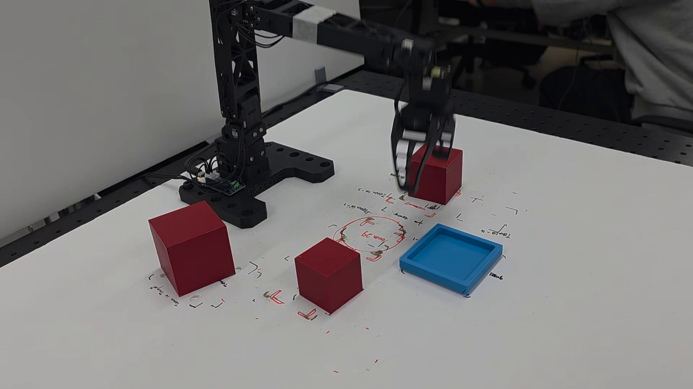
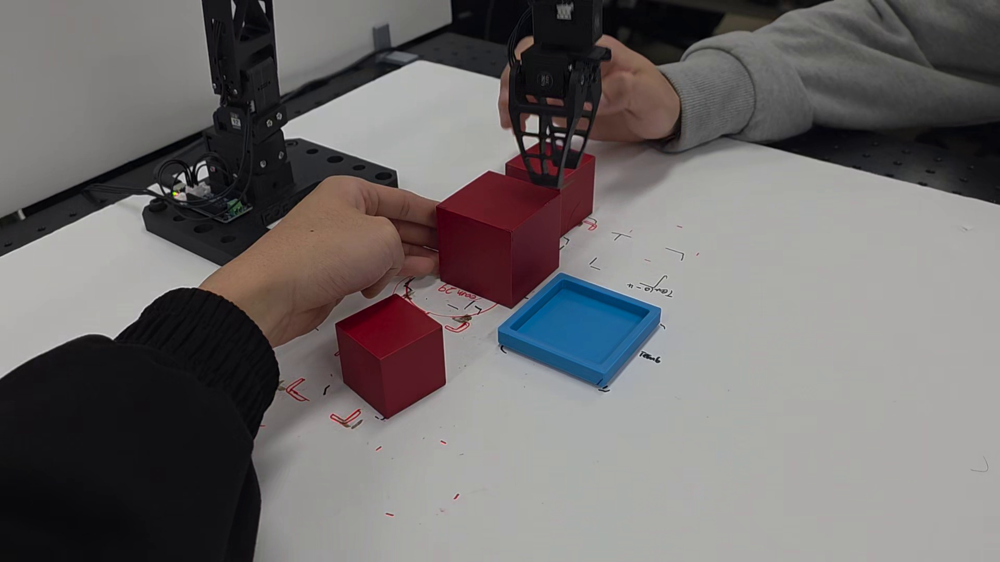
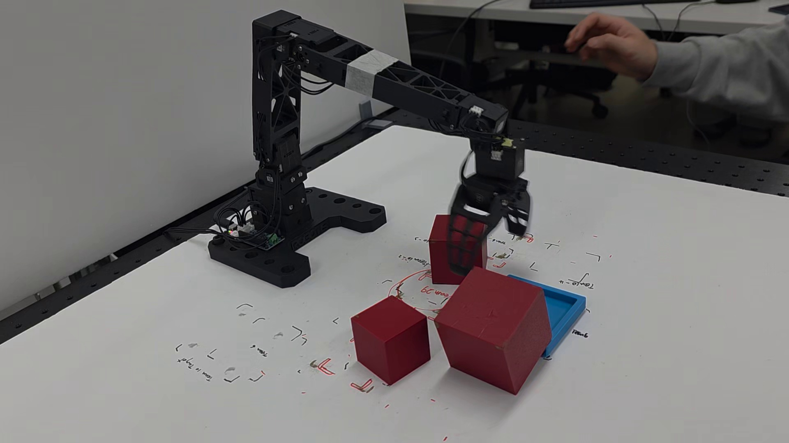
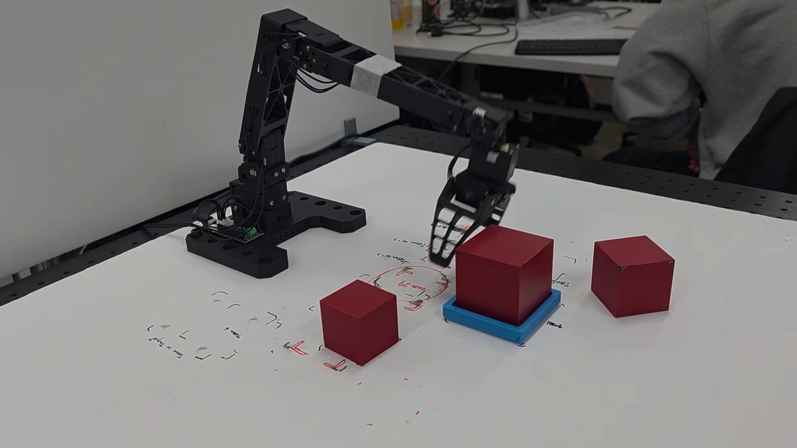
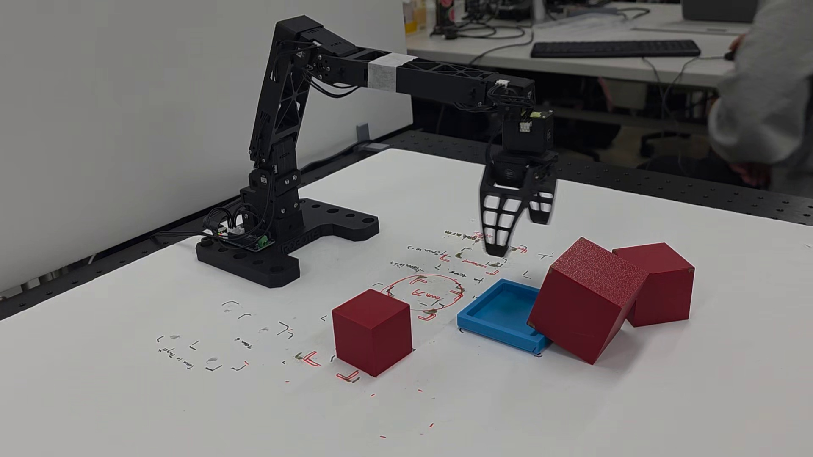
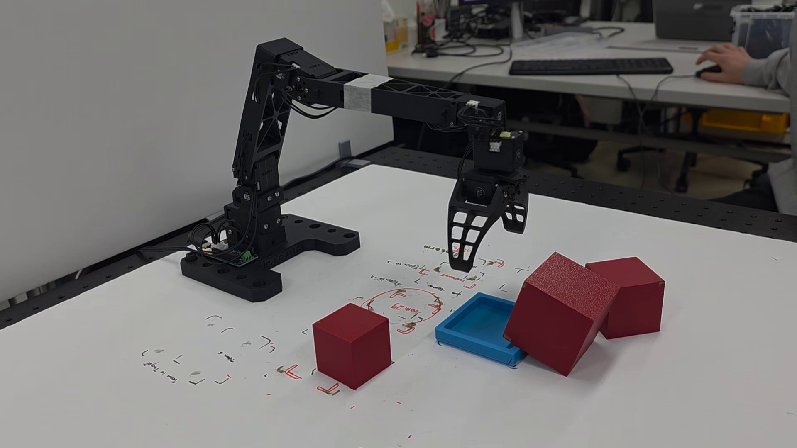
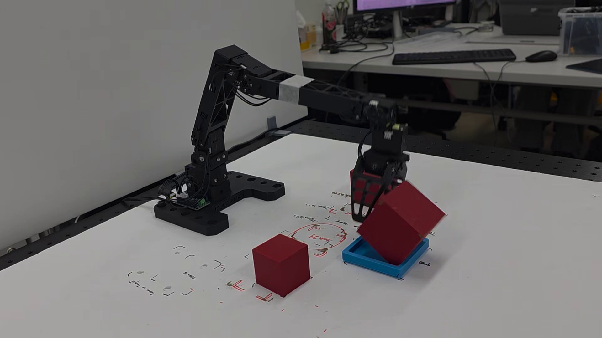
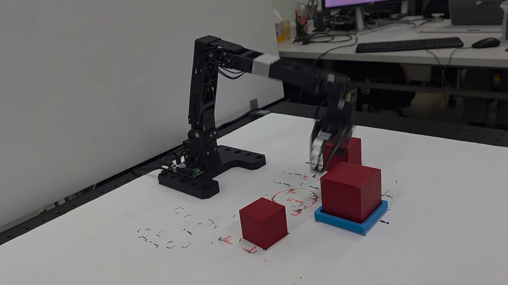
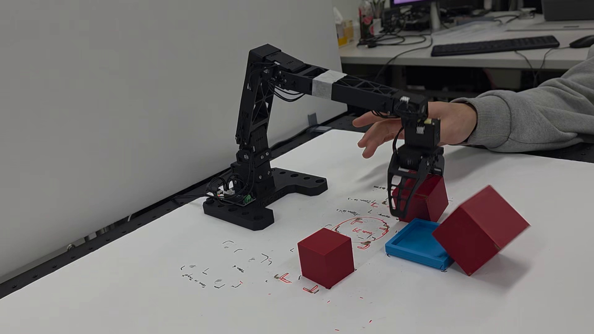

# 실험 결과 및 분석

학습 loss는 약 3.4에서 약 0.10으로 안정적으로 수렴했습니다. 하지만 11/18 실제 로봇 실행에서는 기본 조건과 변형 조건 모두 성공하지 못해 성공률은 0%였습니다.

아래 분석에서 **[사실]** 은 설정 파일·관찰로 확인한 것, **[추정]** 은 팀의 분석입니다.

## 1. 학습 결과

| step | loss (그래프에서 읽은 근사값) |
| --- | --- |
| 1,000 | 약 3.4 |
| 5,000 | 약 0.45 |
| 15,000 이후 | 완만하게 수렴 |
| 25,000 (추론에 사용) | 29,000 step과 약 0.01 차이 |
| 29,000 (마지막 기록) | 약 0.10 |

- 5,000 step까지 loss가 초기값의 약 87% 줄었습니다.
- 25,000 step과 29,000 step의 차이는 약 0.01이고, 튀는 구간 없이 안정적으로 학습됐습니다.
- 이 loss는 학습 데이터 기준입니다. 검증 데이터와 시뮬레이션 평가 환경이 없어 과적합 여부는 loss만으로 판단할 수 없습니다.

## 2. 로봇 실행 결과

데이터 수집 때와 같은 작업대에 블록을 놓고 25,000 step 모델을 실행했습니다. 로봇이 멈추면 Finish로 종료하고, 팔을 받친 채 토크를 풀어 원위치시킨 뒤 다시 시도했습니다.

| 조건 | 확인하려 한 것 | 결과 |
| --- | --- | --- |
| 기본: 수집 때와 같은 위치에 블록 3개 | 작업을 처음부터 끝까지 수행하는가 | 실패 |
| 변형 ①: 그리퍼에 블록을 손으로 넣어 줌 | 잡기를 건너뛰면 옮기기·놓기는 하는가 | 실패 |
| 변형 ②: 큰 블록을 미리 트레이에 옮겨 둠 | 옮겨진 블록을 인식하고 두 번째 블록부터 집는가 | 실패 |
| 변형 ③: 블록 2개를 미리 쌓아 둠 | 남은 마지막 블록만 쌓는가 | 실패 |
| **합계** | | **성공 0회, 성공률 0%** |

기본 조건에서 여러 번 시도해도 완수할 가능성이 보이지 않아, 작업을 단계별로 나눠 어느 단계에서 막히는지 확인하려고 변형 실험을 했습니다.

- **변형 ①:** 블록을 그리퍼에 직접 넣어 주어도 트레이로 옮겨 놓지 못했습니다. 실패 원인은 "잡기"만의 문제가 아닙니다.
- **변형 ②·③:** 로봇은 남은 블록을 집으러 가지 않고 트레이 위 블록 쪽으로 가서 그 블록을 건드렸습니다. 모델이 현재 장면을 보고 진행 단계를 판단하지 못한 것입니다.
- **공통:** 블록과 트레이 쪽으로 대략적인 경로는 따라가지만, 블록 바로 위에서 정밀하게 잡거나 놓지 못하고 블록을 밀거나 쓰러뜨린 뒤 맴돌다 멈췄습니다.

### 영상별 진행

| 영상 | 시작 배치 | 진행 과정 | 결과 |
| --- | --- | --- | --- |
| A (59초) | 기본 배치 | 7초에 출발해 뒤쪽 블록 위에서 그리퍼를 열지만 잡지 못함. 17초부터 사람이 블록을 그리퍼에 넣어 줌(변형 ①). 블록을 트레이에 올려 두자 그 위로 접근했으나 52~57초에 블록이 트레이 밖으로 밀려남 | 실패 |
| B (29초) | 블록 2개가 트레이 위에 쌓여 있음(변형 ③) | 9초에 출발해 바닥의 블록이 아니라 쌓인 블록 쪽으로 감. 12초에 위 블록을 밀어 떨어뜨리고, 18초에 남은 블록과 트레이까지 밀어낸 뒤 허공에서 멈춤 | 실패 |
| C (70초) | 큰 블록을 미리 트레이에 옮겨 둠(변형 ②) | 트레이 위 블록 쪽으로 감. 15초에 블록이 기울고 18~33초에 트레이 위에서 맴돎. 51초에 큰 블록이 트레이 밖으로 떨어짐 | 실패 |

| A: 블록 접근 | A: 손으로 블록 넣기 (변형 ①) | A: 블록 밀려남 |
| --- | --- | --- |
|  |  |  |

| B: 위 블록 밀어냄 (변형 ③) | B: 트레이 밖으로 밀림 | B: 허공에서 멈춤 |
| --- | --- | --- |
|  |  |  |

| C: 블록 기울어짐 (변형 ②) | C: 트레이 위에서 맴돎 | C: 블록 떨어짐 |
| --- | --- | --- |
|  |  |  |

## 3. 실패 원인 분석

### 3.1 loss는 낮은데 왜 실패했나

- [사실] 학습 loss는 약 0.10까지 내려갔지만 실제 성공은 0회입니다.
- [추정] 학습 loss는 "시연을 얼마나 잘 따라 하는가"를 재는 것이지 "실제로 성공하는가"를 재는 것이 아닙니다. 모델은 시연 데이터는 잘 재현하지만, 실행 중 조금이라도 달라진 장면에는 대응하지 못했습니다.
- [추정] 변형 ②의 실패가 특히 중요합니다. 큰 블록이 이미 트레이 위에 있는 장면은 시연에서 "에피소드 중간"에만 나타나고, 로봇이 초기 자세에서 이 장면을 마주한 적은 없습니다. 모델은 장면을 보고 다음 할 일을 판단하기보다, 초기 자세에서 시작하는 시연 궤적을 통째로 외운 것에 가깝습니다.

### 3.2 주요 요인

**① 긴 action chunk와 중간 보정 부재**

- [사실] chunk_size와 n_action_steps가 모두 100이고 temporal ensembling은 꺼져 있습니다. 30 fps 기준 약 3.3초마다 한 번만 새 관측을 봅니다.
- [추정] 그리퍼가 블록을 살짝 빗나가거나 블록이 밀려도 다음 예측까지 그대로 진행해, 잡기·놓기 실패로 이어졌을 가능성이 있습니다.

**② 관측의 한계: 카메라 1대**

- [사실] 입력 영상은 정면 camera1 하나뿐이며 깊이 정보나 손목 카메라는 없습니다.
- [추정] 블록 위에 블록을 올리는 단계는 높이 정렬이 중요한데, 한 시점의 영상만으로는 앞뒤·위아래 간격을 구분하기 어렵습니다.

**③ 블록 간 시각적 혼동**

- [사실] 블록 3개가 모두 같은 빨간색이고 크기만 다릅니다. 지시문은 모델 입력에 들어가지 않습니다.
- [추정] 모델은 "큰 블록부터"라는 규칙을 이해한 것이 아니라 시연의 동작 순서를 외운 것입니다.

**④ 학습 step과 작업 난이도**

- [사실] 추론에 쓴 모델은 25,000 step입니다. 실습 조교 설명으로는 더 쉬운 pick-and-place도 30,000 step쯤부터 수렴하기 시작합니다.
- [추정] 블록 쌓기는 집기·옮기기·정렬해 놓기를 세 번 이어가야 해서 단순 작업보다 학습이 덜 됐을 가능성이 큽니다. 다만 step만 늘린다고 해결되지는 않으며, 데이터 품질이 더 중요하다고 봅니다.

**⑤ 카메라 시야와 조명**

- [사실] 수집은 11/10·11/11, 추론은 11/18이었고 영상 증강은 꺼져 있었습니다.
- [추정] 두 시점의 조명·그림자 차이가 ResNet18이 보는 영상 특징을 바꿔, 학습 때 본 적 없는 입력이 됐을 수 있습니다.

### 3.3 데이터의 양과 품질

- [사실] 학습 에피소드는 23개입니다. ACT 논문은 태스크당 약 50개를 썼고, 수업에서는 복잡한 작업에 50~100개를 권장했습니다.
- [추정] 에피소드가 적고 증강이 없어, 조명이나 블록 위치가 수집 때와 조금만 달라도 성능이 떨어졌을 것입니다.
- [추정] 시연 속도가 회차마다 달랐다면 같은 장면에 서로 다른 정답이 주어진 셈입니다. CVAE가 이 차이를 일부 흡수하지만 추론 때는 z = 0으로 평균적인 동작만 냅니다. 여러 동작의 평균은 어느 쪽으로도 진행하지 못하는 어중간한 동작이 되기 쉽고, 관찰된 멈춤의 한 원인일 수 있습니다.

## 4. ACT vs SmolVLA

| 항목 | ACT (본 팀 설정) | SmolVLA (문헌) |
| --- | --- | --- |
| 모델 유형 | 단일 태스크 모방학습 정책 | Vision-Language-Action 범용 정책 |
| 입력 | 카메라 1대 영상 + 관절 상태 6 | 카메라 영상 + 로봇 상태 + 언어 지시 |
| 행동 생성 | 디코더가 한 번에 회귀 예측 | Flow Matching으로 노이즈를 행동으로 변환 |
| 사전학습 | 영상 백본만 ImageNet 사전학습 | 커뮤니티 로봇 데이터로 사전학습 후 fine-tuning |
| 모델 크기 | 약 5,170만 파라미터 | 약 4.5억 파라미터 |
| 장점 | 가볍고 빠름, 구조가 단순해 분석이 쉬움 | 언어로 작업 전환, 새 환경에 일반화가 더 나음 |
| 단점 | 언어 이해 불가, 태스크마다 재학습 | 크고 느림, GPU 자원이 더 필요 |

고정된 단일 작업에는 ACT가 더 적합하다고 판단했습니다. 다만 "큰 것부터 / 작은 것부터 쌓아 줘"처럼 같은 블록으로 순서만 바꾸는 지시나, 첫 블록이 이미 옮겨진 장면에서 남은 일을 판단하는 상황에서는 SmolVLA가 유리할 수 있습니다. SmolVLA는 직접 실험하지 않았으므로 이 부분은 추정입니다.

## 5. 개선 방안

| 우선순위 | 개선안 | 겨냥하는 문제 |
| --- | --- | --- |
| 1 | temporal ensembling 켜기 또는 n_action_steps를 20~30으로 줄이기 | 중간 보정 부재. 재학습 없이 추론 설정만으로 확인 가능 |
| 2 | 블록 위치를 고정하고, 시연자가 연습 후 일정한 속도로 재수집 | 시연 일관성 |
| 3 | 에피소드를 50~100개로 늘리고, 녹화 직후 검수 | 데이터 양, 손상 데이터 |
| 4 | 손목 카메라 추가, 수집·추론을 같은 조명에서 | 관측 부족, 환경 변화 |
| 5 | 영상 증강 켜기 (이미 설정된 ColorJitter 등) | 조명 변화에 대한 강건성 |
| 6 | 처음부터 30,000 step 이상 다시 학습, 저장 간격 1,000 step | 학습 부족, 중단 시 손실 |
| 7 | 작업을 단계별로 나눠 학습하거나 SmolVLA로 언어 지시 활용 | 순서 혼동, 단계 판단 |

## 6. 결론

리더-팔로워 시연 23개로 ACT 정책을 학습해 블록 쌓기를 실제 로봇에서 시도했습니다. 학습 loss는 수렴했지만 실제 로봇 성공률은 0%였고, 원인을 데이터의 양과 일관성, 긴 action chunk, 카메라 1대의 관측 한계, 학습 step, 조명 조건으로 분석했습니다.

- **모방학습:** 보상 설계 없이 시연만으로 정책을 얻을 수 있지만, 정책의 수준은 시연의 양과 일관성을 넘지 못합니다.
- **ACT:** Action Chunking과 CVAE로 적은 데이터에서도 부드러운 동작을 만들지만, chunk 길이와 추론 방식이 실행 중 보정 능력을 좌우합니다.
- **실제 로봇:** 학습 loss가 낮아도 실제 성공은 별개였습니다. 시작 자세, 물체 위치, 조명을 수집 때와 똑같이 맞추고, 수집한 데이터를 바로 검수하는 절차가 중요했습니다.
